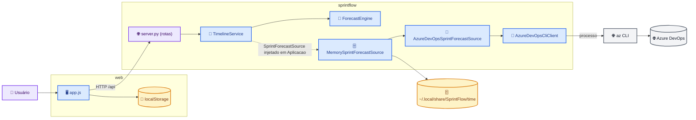
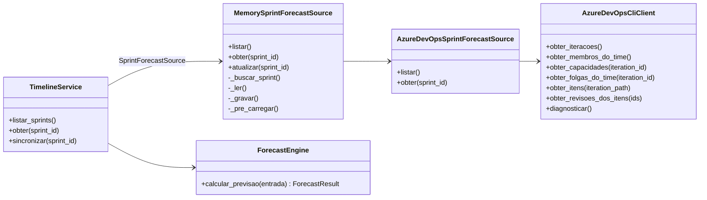
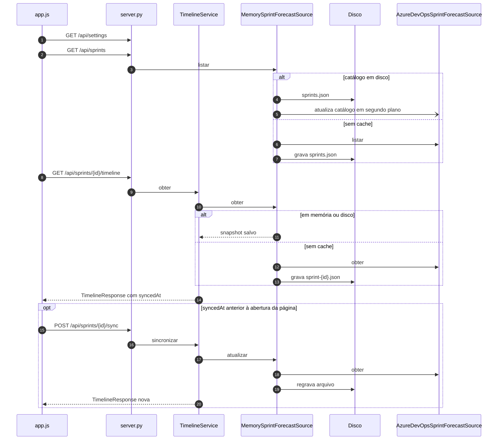
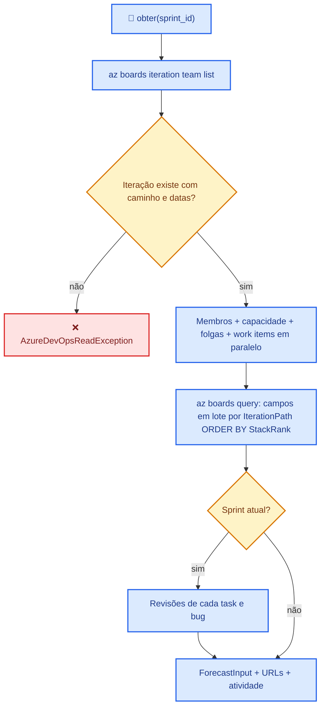
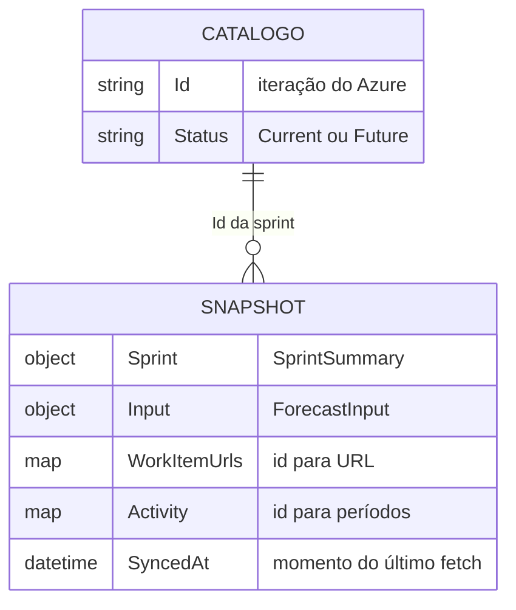
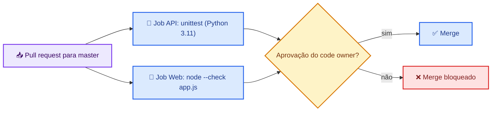
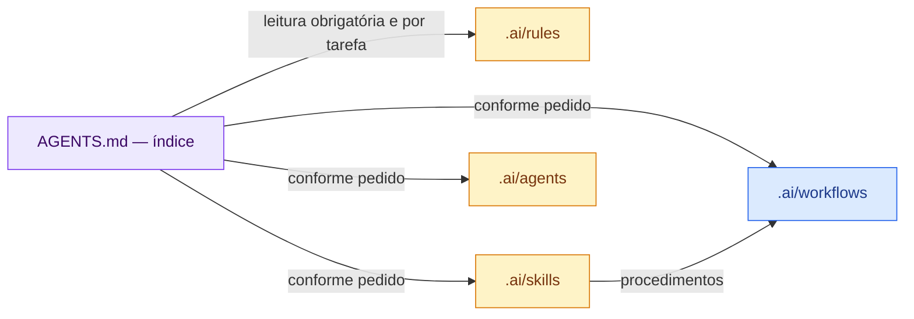

# Arquitetura — SprintFlow (Gantt local da sprint lido do Azure DevOps)

Ferramenta local para a daily de uma squad: mostra USs e tasks na ordem do backlog, o histórico de estados e a previsão de término.

Este documento descreve **as partes do sistema, como os dados saem do Azure DevOps até a tela, as regras de ordenação e previsão, o cache local e os limites conhecidos**. Não contém segredos nem dados pessoais.

> **Legenda das cores (flowcharts)**
> 🟪 roxo = entrada / API · ⬜ cinza = externo / neutro · 🟨 amarelo = dados / decisão · 🟦 azul = processo / retorno · 🟥 vermelho = erro / parada
>
> **Legenda das setas (flowcharts)**
> `-->` sólida = ligação confirmada no código · `-.->` tracejada = ligação inferida (DI, interface, reflection, configuração ou convenção de nome)

O que foi verificado por leitura ou execução está na seção 9.

## 1. Visão geral

| Camada | O que faz | Acessa Azure DevOps? | Onde está |
| --- | --- | --- | --- |
| **Tela** | Timeline por US, barras das tasks, sync automático, preferências | ❌ não | `web/app.js`, `web/styles.css` |
| **API** | Rotas HTTP e arquivos estáticos do front | ❌ não | `sprintflow/server.py` |
| **Timeline** | Monta a resposta da tela a partir do plano | ❌ não | `sprintflow/timeline.py` |
| **Previsão** | Aloca horas por pessoa e calcula bloqueios | ❌ não | `sprintflow/forecast.py` |
| **Cache** | Memória + disco por sprint e catálogo | ❌ não | `sprintflow/cache.py` |
| **Fonte Azure** | Converte work items, membros, capacidade e revisões | ✅ via CLI | `sprintflow/azure_source.py` |
| **Cliente CLI** | Executa `az` como processo e lê o JSON | ✅ sim | `sprintflow/azure_cli.py` |



O backend serve o front sem build: `server.py` entrega os arquivos de `web/` e responde `index.html` para caminhos inexistentes ou fora da pasta. O servidor é um `ThreadingHTTPServer` da biblioteca padrão; não há dependências externas. `python3 -m sprintflow` sobe em `127.0.0.1:5002`, alterável por `SPRINTFLOW_HOST` e `SPRINTFLOW_PORT`.

**Por que assim**

| Problema | Como o desenho resolve |
| --- | --- |
| O Azure DevOps é a fonte da verdade e não pode ser alterado | Só há leitura, sempre via `az` CLI. Não existe rota nem método de escrita. |
| Autenticação de cada usuário | Reaproveita a sessão do `az login`; o projeto não guarda credencial. |
| Carga completa no Azure leva dezenas de segundos | Cache em memória e disco; a tela abre com o último dado e sincroniza em segundo plano. |

## 2. Componentes



A ligação `TimelineService` → `MemorySprintForecastSource` é feita em `Aplicacao` (`server.py`), que recebe o `Protocol` `SprintForecastSource`. Cada serviço tem uma instância por processo, compartilhada pelas threads do servidor.

| Arquivo | Responsabilidade |
| --- | --- |
| `sprintflow/__main__.py` | Entrada `python3 -m sprintflow`; lê `SPRINTFLOW_HOST` e `SPRINTFLOW_PORT`. |
| `sprintflow/server.py` | `ThreadingHTTPServer`, montagem dos serviços (`Aplicacao`), rotas `/api/*`, arquivos de `web/`, filtro de host e erros em `application/problem+json`. |
| `sprintflow/config.py` | Lê `appsettings.json` e o `appsettings.Local.json` opcional na raiz e mescla as seções `AllowedHosts`, `AzureDevOps` (`Organization`, `Project`, `Team`, `ExecutablePath`, `CommandTimeoutSeconds`) e `Forecast`. |
| `sprintflow/azure_cli.py` | `AzureDevOpsCliClient`: executa `az` via `subprocess`, lê os campos dos work items em lote via WIQL e aplica timeout e paralelismo de 6 leituras de revisões (`ThreadPoolExecutor`); contém os parsers de JSON (`ler_itens`, `ler_revisoes`). |
| `sprintflow/azure_source.py` | Classifica work items, normaliza estados, deriva papel e estágio, monta períodos de atividade. |
| `sprintflow/cache.py` | `MemorySprintForecastSource`: cache em memória e disco, sync e aquecimento das sprints em threads de segundo plano. |
| `sprintflow/forecast.py` | `ForecastEngine`: previsão por capacidade e dependência entre estágios. |
| `sprintflow/models.py` | Dataclasses de entrada e saída da previsão, da timeline e do cache; serialização JSON em camelCase (`para_json`) e leitura do cache (`ler_dataset`, `ler_sprint`). |
| `sprintflow/timeline.py` | `TimelineService` e `Protocol` `SprintForecastSource`. Monta `TimelineResponse` (pessoas, tasks, USs com seu estado em `state`, resumo). A tela exibe esse estado ao lado do ID da US. `TimelineStory` também recebe `description` e `azure_url` para o modal da US. |
| `web/index.html` | Página única que carrega `styles.css` e `app.js`. |
| `web/app.js` | Tela inteira: carga, sync automático, cálculo das barras e faixas, modal. JavaScript sem framework, com `// @ts-check` e tipos em JSDoc. |
| `web/styles.css` | Tema e layout da timeline. |
| `run.sh` / `stop.sh` | Start em segundo plano e encerramento pelo PID. |

`run.sh` verifica se o interpretador (`python3` ou `SPRINTFLOW_PYTHON`) é 3.11 ou superior; caso contrário, encerra com mensagem. Depois inicia `python3 -m sprintflow` com `nohup setsid`, grava o PID em `.run/backend.pid` e o log em `.run/backend.log`. Não há build nem instalação de pacotes.

## 3. Fluxo principal: abrir a tela



- O sync automático roda uma vez por sprint em cada aba (`autoSynced` em `app.js`).
- A timeline dimensiona as colunas para cinco dias úteis na área visível, com mínimo de 110px por dia e rolagem horizontal. Os títulos das USs permanecem fixos. Ao abrir ou trocar de sprint, centraliza o momento atual se estiver dentro da sprint atual, limitado às bordas; as demais abrem no início. O sync preserva a posição escolhida pelo usuário.
- `TimelinePerson.days_off` expõe apenas as folgas individuais; `TimelineResponse.team_days_off` expõe as coletivas, persistidas em `SprintForecastDataset.team_days_off`. O sync consulta `teamdaysoff` via CLI em paralelo com a capacidade. A previsão combina as duas listas por pessoa, sem modificar o snapshot. Caches antigos sem folgas coletivas continuam legíveis e recebem esses dados no próximo sync. Datas de folga mantêm o dia calendário informado pelo Azure, sem conversão de fuso. A tela destaca a coluna coletiva em vermelho discreto, inclusive nas USs recolhidas, e hachura apenas o trecho da barra que coincide com a folga individual do responsável. A folga coletiva prevalece visualmente quando as duas coincidem.
- `MemorySprintForecastSource.listar` só retorna sprints com status `Current` ou `Future`.
- Ao carregar o catálogo, `_pre_carregar` chama `obter` para cada sprint, começando pela atual, em uma thread de segundo plano.

## 4. Fluxo de leitura do Azure DevOps



- Falha ao ler capacidade não interrompe a carga: `_carregar_capacidades` devolve lista vazia.
- Cada comando `az` tem timeout de `CommandTimeoutSeconds`, limitado entre 5 e 300 segundos.

## 5. Regras de negócio

| Tema | Regra |
| --- | --- |
| Tipos de item | `User Story` e `Product Backlog Item` são USs. `Task` e `Bug` são itens filhos. Outros tipos são ignorados. |
| Vínculo | Item filho sem `System.Parent` é descartado. Pai fora da sprint vira US placeholder com título `US #<id>`. |
| Ordem das USs | `Microsoft.VSTS.Common.StackRank`, fallback `BacklogPriority`, depois id. US sem ordem recebe a posição na lista ordenada. |
| Ordem das tasks | Dentro da US: ordem do Azure, depois id. As barras são empacotadas em faixas nessa ordem. |
| Estados | `new`/`to do`/`todo` → `Todo`; `active`/`in progress`/`doing` → `In Progress`; `resolved`/`review` → `Review`; `closed`/`done` → `Done`. |
| Esforço | `RemainingWork`, fallback `OriginalEstimate`, senão 0. |
| Papel da pessoa | Atividade de maior capacidade diária: contém `back` → Backend; `front` → Frontend; `qa`/`test` → QA; `pd`, `el`, `gpm`, `pm` exatos; senão PD. |
| Estágio da task | Título contém `front` ou ` ui` → Frontend; `qa`/`test` → QA; `back`/`api` → Backend; senão o papel do responsável; senão Other. |
| Ordem da previsão | Estágio (Backend, Frontend, QA, Other), depois ordem da US, ordem da task e id. |
| Dependências | Frontend começa no horário em que termina o último Backend aberto da mesma US. QA espera Backend e Frontend da US. Horas de espera por dia viram `FlowBlockage`. |
| Fila por pessoa | Uma task por vez. Task `In Progress` com início no histórico começa no primeiro `Active`, termina em agora + esforço restante e entra antes da fila, independentemente da ordem; várias em andamento da mesma pessoa ficam sobrepostas. Demais tasks seguem a ordem e começam no maior entre `System.CreatedDate`, agora e o fim da anterior. Sem histórico, `In Progress` segue a fila. |
| Alocação | Horas por dia até a capacidade da pessoa, distribuídas no expediente `Forecast:WorkdayStart`–`Forecast:WorkdayEnd` (padrão 08:00–18:00); cada segmento expõe `Start` e `End`; pula sábado, domingo, folgas individuais e folgas do time inteiro. Task com fim após o fim da sprint recebe `exceeds_sprint`. |
| Sem previsão | Task sem responsável da squad, sem esforço restante ou com capacidade 0 vai para `ignored_task_ids`. |
| Atividade | Só na sprint atual. Revisões em sequência com mesmo estado e responsável são unidas. `In Progress` → Active; `Review` → Review; `Done` → Done; outro estado → Assigned antes do início, Paused depois. |
| Dia de referência | Sprint atual: hoje, limitado ao intervalo da sprint. Outras sprints: data de início. |
| USs concluídas (métrica) | Estado da própria US no Azure igual a `Done`, independentemente do estado ou da existência de tasks. API fornece `isDone` para o contador e recolhimento na tela. |
| Barras | Coluna do dia = 24h; posição `(hora + minuto/60) / 24`. Início no primeiro `Active`; sem esse registro, usa o primeiro `Review` ou `Done`. Sem início registrado, usa o `Start` do primeiro segmento ou agora. Criação e atribuição ficam somente no histórico. Fim no `Done` ou agora, estendido até o `End` do último segmento previsto. |

Mensagem de erro que chega ao usuário, com dado fictício:

```text
A sprint solicitada não foi encontrada entre as 12 iterações disponíveis para o time configurado.
```

## 6. Dados

Não há banco. Os dados persistidos são arquivos JSON de cache e uma preferência no navegador.



- Local: `~/.local/share/SprintFlow/{Team}/` (ou `$XDG_DATA_HOME/SprintFlow/{Team}/`, quando definido). `sprints.json` guarda o catálogo; `sprint-<id>.json` guarda cada `SprintForecastDataset`.
- O nome da pasta é o `Team` com `/` e caracteres de controle trocados por `_`.
- Enums (`SquadRole`, `WorkStage`) são gravados como inteiros, compatíveis com os caches anteriores; a API os expõe pelo nome.
- A previsão (`ForecastResult`) não é salva: é recalculada a cada requisição a partir do snapshot.
- `ForecastInput.forecast_date` mantém o nome JSON `planningDate` para compatibilidade com os caches existentes.
- A descrição HTML (`System.Description`) segue do cliente CLI para `ForecastStory.description`, cache e `TimelineStory.description`; caches anteriores continuam válidos e recebem a descrição no próximo sync. A tela exibe o HTML em iframe sem permissões de sandbox, com scripts bloqueados por CSP.
- Um clique na US abre seus detalhes e tasks vinculadas; o clique é adiado por 350 ms para permitir que o duplo clique cancele o modal e alterne o recolhimento individual.
- Duplo clique em **USER STORY** recolhe todas ou expande TODO, IN PROGRESS e TESTING/TESTINGS quando a preferência estiver marcada; desmarcada, expande todas. A ação altera somente a expansão da tela, sem persistir uma nova preferência.
- Navegador: `localStorage['sprintflow.collapseDone']` guarda a preferência de recolher USs concluídas.

## 7. Cache, sync e retomada

| Situação | O que acontece |
| --- | --- |
| Primeira abertura sem cache | Carga completa no Azure; o resultado é salvo em disco. |
| Reinício do backend | Catálogo e sprints vêm do disco; o catálogo é atualizado em segundo plano. |
| Abrir ou trocar de sprint na tela | Mostra o snapshot e dispara sync em segundo plano se `syncedAt` for anterior à abertura da página. |
| Sync manual (**SYNC SPRINT**) | `atualizar` busca no Azure, troca a memória e regrava o arquivo. |
| Falha no sync | A tela mantém os dados anteriores e mostra o erro; o arquivo não é alterado. |
| Arquivo corrompido ou formato antigo | `_ler` registra aviso e trata como cache vazio. |
| Falha ao gravar | `_gravar` registra aviso; a resposta segue normalmente. |
| Concorrência | `threading.Lock` por sprint e para o catálogo; escrita atômica com arquivo `.tmp` + `Path.replace`. |

O catálogo carregado do disco não é substituído na tela até recarregar a página.

## 8. Rotas, erros e mensagens

| Rota | Método | Uso |
| --- | --- | --- |
| `/api/status` | GET | Diagnóstico: CLI, extensão, login e configuração (`diagnosticar`). |
| `/api/settings` | GET | Devolve `{ team }` para o topo da tela. |
| `/api/sprints` | GET | Catálogo; responde 503 se `AzureDevOps` não estiver configurado. |
| `/api/sprints/{sprintId}/timeline` | GET | Timeline da sprint (cache primeiro). |
| `/api/sprints/{sprintId}/sync` | POST | Força leitura no Azure e devolve a timeline nova. |

| Situação | Exceção | Mensagem |
| --- | --- | --- |
| `az` não instalado | `OSError` tratada | `Azure CLI não encontrado.` |
| Timeout do comando | `subprocess.TimeoutExpired` tratada | `A consulta excedeu o tempo limite.` |
| Comando `az` com erro | `AzureDevOpsReadException` | stderr do `az` |
| Sprint inexistente | `AzureDevOpsReadException` | `A sprint solicitada não foi encontrada…` |
| Falha ao carregar sprints (tela) | — | `Configure o time em appsettings.Local.json e verifique o Azure CLI.` |
| Falha no sync (tela) | — | `Sync falhou. Os dados anteriores continuam na tela.` |

Na API, `AzureDevOpsReadException` e erros inesperados viram 500 em `application/problem+json` (`title`, `status`, `detail`); erros inesperados recebem a mensagem genérica `Erro inesperado no servidor.` e o stack trace fica só no log. Quando a fonte não devolve dados da sprint, timeline e sync respondem 404 em texto; rota desconhecida em `/api/` também responde 404.

## 9. Integração externa e autenticação

| Comando `az` | Uso | Evidência |
| --- | --- | --- |
| `boards iteration team list` | Sprints do time | código |
| `devops team list-member` | Membros | código |
| `devops invoke --area work --resource capacities` | Capacidade e folgas | código |
| `devops invoke --area work --resource teamdaysoff` | Folgas do time inteiro | código + execução |
| `boards query --wiql` | IDs e campos da sprint em lote, na ordem do backlog | código + execução |
| `devops invoke --area wit --resource revisions` | Histórico de estados | código |

Nenhum comando de escrita é usado. A credencial é a sessão do `az login`; o projeto não lê nem guarda token. `AZURE_CORE_ONLY_SHOW_ERRORS=true` é definido no processo filho.

A API só aceita os hosts `localhost` e `127.0.0.1` (`AllowedHosts` em `appsettings.json`). Requisições com outro `Host` recebem 400, o que impede um site externo de ler os dados via DNS rebinding.

## 10. CI e proteção da `master`



| Arquivo | Papel |
| --- | --- |
| `.github/workflows/ci.yml` | Jobs `API` e `Web` em PRs e pushes para `master`. |
| `.github/rulesets/master.json` | Bloqueia push direto, force-push e exclusão; exige PR, 1 aprovação do code owner e os checks `API` e `Web` com a branch atualizada. Administradores podem fazer bypass só via PR. |
| `.github/CODEOWNERS` | Define o aprovador obrigatório de todos os arquivos. |

O ruleset é aplicado no GitHub com `gh api` (ver `CONTRIBUTING.md`); o arquivo no repositório é a fonte, não a configuração ativa.

## 11. Limites conhecidos e verificação

| Ponto | Situação |
| --- | --- |
| Pausas | Só aparecem quando houve mudança de estado; períodos sem atualização no Azure não são detectados. |
| Histórico | Revisões só são lidas para a sprint atual. |
| Sprints passadas | Fora do catálogo (`Current` e `Future` apenas). |
| Estágio por título | Heurística por palavra; título ambíguo pode cair no estágio errado. |
| Catálogo do disco | Na virada da sprint, a primeira abertura pode marcar a sprint anterior como atual até recarregar a página. |
| Fuso | Datas de iteração usam UTC; horários das barras usam o fuso do navegador. |

| Fluxo ou afirmação | Fonte no código | Verificação executada | Limite |
| --- | --- | --- | --- |
| Sintaxe do front | `web/app.js` | `node --check web/app.js` sem erros. | Não valida comportamento. |
| Cache em disco sobrevive a reinício | `MemorySprintForecastSource` | Timeline sem cache levou 34,2 s; após reinício, 0,05 s, com o mesmo `syncedAt`. | Medido na versão .NET anterior, com o mesmo formato de cache; não repetido no Python. |
| Sync com campos em lote | `AzureDevOpsCliClient.obter_itens` | Sprint 34: 40,6 s antes e 21,5 s depois; resposta idêntica exceto `syncedAt`. | Medido na versão .NET anterior; uma medição por versão; histórico completo ainda é consultado. |
| Sync regrava arquivo | `atualizar`, `_buscar_sprint` | `POST /sync` atualizou `syncedAt` na resposta e no arquivo. | Verificado na versão .NET anterior. |
| Bugs como filhos da US | `_eh_historia`, `_eh_tarefa` | Conferido via `/timeline` e `az boards work-item show` nos itens da sprint atual. | Verificado na versão .NET anterior. |
| Rotas `/` e `/api/settings` | `server.py` | `curl` retornou `index.html` (também para caminho inexistente) e `{ team }`. | — |
| Tela | `app.js` | Screenshot headless 1920×1080 com USs recolhidas e expandidas. | Feito na versão React anterior; não repetido no `app.js`. Clique, modal e popover não testados. |
| CI e ruleset | `.github/` | Primeiro run do CI passou (jobs `API` e `Web`). Ruleset `Proteger master` aplicado e ativo no GitHub. | Run verificado com os jobs .NET/npm anteriores; os jobs Python e `node --check` ainda não rodaram no GitHub. Nomes dos checks dependem dos jobs `API` e `Web`. |
| Filtro de host | `appsettings.json` (`AllowedHosts`), `server.py` | `curl` com `Host: evil.com` retornou 400; `127.0.0.1` e `localhost` retornaram 200. | — |
| Previsão, timeline e parser | `forecast.py`, `timeline.py`, `azure_cli.py` | `python3 -m unittest discover -s tests`: 23 testes, 23 aprovados. | — |

## 12. Instruções compartilhadas de IA

A estrutura de IA orienta o desenvolvimento; não participa da execução da API, da previsão ou do sync. Todos os recursos ficam em `.ai/`. O `AGENTS.md` da raiz é somente o índice de leitura compartilhado por Claude Code e Codex.

| Local | Responsabilidade | Carregamento |
| --- | --- | --- |
| `AGENTS.md` | Indicar o que ler sempre e por tarefa | Entrada nos clientes compatíveis |
| `.ai/rules/` | Orientações gerais, estilo, segurança, domínio, backend, frontend, testes, documentação e Git | Leitura conforme o índice |
| `.ai/workflows/` | Procedimentos de implementação, correção, revisão, desempenho e validação | Leitura conforme a tarefa ou skill |
| `.ai/skills/` | Skills de validação, revisão e documentação | Leitura pelo caminho indicado no índice ou no pedido |
| `.ai/agents/` | Perfis de revisor e investigador | Leitura pelo agente principal; não registra subagentes |
| `.ai/templates/` | Modelos de regra, workflow, perfil, plano, PR e decisão | Cópia e edição pelo usuário; não são políticas ativas |
| `.ai/evals/` | Cenários de avaliação do comportamento das instruções | Avaliação manual em ambiente isolado |
| `.ai/hooks/` | Guia para uma eventual automação por eventos | Nenhum hook ativado |
| `.ai/scripts/validate.py` | Conferência de referências e metadados das skills | Execução manual com Python 3.11+ |



`.ai/` é uma convenção local; não há adaptadores nem links de descoberta nativa. Skills e perfis são documentos encaminhados pelo índice, sem comandos de skills ou registro automático de subagentes. O validador comprova integridade estrutural, não leitura nem obediência pelo cliente. Confira o carregamento do `AGENTS.md` e dos documentos pertinentes em uma sessão nova; Claude não estava instalado no ambiente de criação. Detalhes de uso e manutenção estão em `.ai/README.md`.

As funções próprias do backend, frontend, auxiliares e testes usam nomes em pt-BR. Identificadores de classes, campos JSON, rotas, arquivos e nomes exigidos por bibliotecas foram preservados. Na versão Python, funções seguem `snake_case` e, no `app.js`, `camelCase`.
